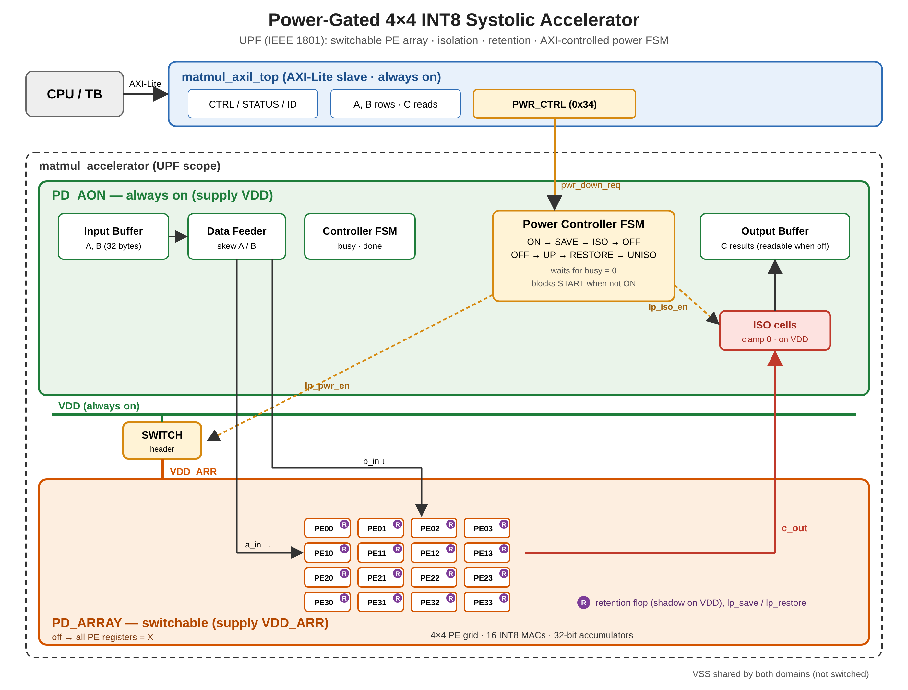
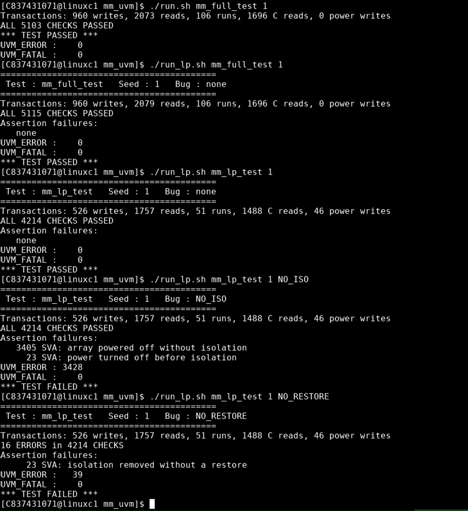

# Power-Gated 4×4 INT8 Systolic Matmul Accelerator

A 4×4 output-stationary systolic array (16 INT8 MAC units, 32-bit accumulators) behind an AXI4-Lite slave interface, with:

- **UVM verification environment**: AXI4-Lite agent, scoreboard with reference model, constrained-random stimulus
- **Low-power design**: IEEE 1801 (UPF) power intent that puts the PE array in a switchable power domain, with isolation and retention, plus an RTL power controller driven by an AXI register
- **Power-aware verification** in Cadence Xcelium (`-lps_1801`), with SVA checks on the power sequence and bug-injection tests
- **Logic synthesis** in Cadence Genus on SKY130 HD at 250 MHz



---

## Architecture

```
matmul_axil_top            AXI4-Lite slave (always on)
└── U_CORE  matmul_accelerator         <- UPF scope
    ├── U_BUFFER      input_buffer     A, B matrices          PD_AON
    ├── U_FEEDER      data_feeder      skews A/B into array   PD_AON
    ├── U_CONTROLLER  controller       IDLE/CLEAR/COMPUTE/DONE PD_AON
    ├── U_OUTPUT      output_buffer    C results              PD_AON
    ├── power controller FSM           lp_* control signals   PD_AON
    └── U_ARRAY       pe_array         16 PEs                 PD_ARRAY (switchable)
```

### Register map

| Address | Register | Access | Description |
|---|---|---|---|
| 0x00 | CTRL | R/W | bit0 START (pulse, reads 0), bit1 IRQ_EN, bit2 ACCUMULATE |
| 0x04 | STATUS | R | bit0 busy, bit1 done (sticky) |
| 0x08 | ID | R | 0x4D4D_0001 |
| 0x10–0x1C | A rows 0–3 | W | 4 × INT8 per row |
| 0x20–0x2C | B rows 0–3 | W | 4 × INT8 per row |
| 0x34 | PWR_CTRL | R/W | W: bit0 = 1 power down array, 0 power up. R: bit0 request, bit4 array ON, bit5 array OFF |
| 0x40–0x7C | C[i][j] | R | 32-bit results, address = 0x40 + 4·(4i + j) |

Unmapped addresses return SLVERR. A START issued while the array is not fully on is refused with SLVERR.

---

## Low-power design

### Power domains (`uvm/accel.upf`)

| Domain | Contents | Supply |
|---|---|---|
| PD_AON | Everything in the core except the array | VDD (always on) |
| PD_ARRAY | `U_ARRAY` (16 PEs) | VDD_ARR (output of the power switch) |

| Structure | Implementation |
|---|---|
| Power switch | Header switch, VDD → VDD_ARR, controlled by `lp_pwr_en` |
| Isolation | All PD_ARRAY outputs (`c_out`) clamped to 0 while `lp_iso_en` = 1, powered by SS_AON |
| Retention | PD_ARRAY registers saved on `lp_save`, restored on `lp_restore`, shadow on SS_AON. Needed for ACCUMULATE mode across a power cycle |
| Level shifters | Not needed (single voltage) |

**Why the array:** in synthesis the PE array is **71% of the core area** (see below), so it holds most of the logic that would leak while idle. The C results live in the always-on output buffer, so they stay readable while the array is off.

### Power controller FSM (`rtl/matmul_accelerator.sv`)

```
Power down:  ON -> SAVE -> ISO -> OFF          (save, isolate, switch off)
Power up:    OFF -> UP (wait 3) -> RESTORE -> UNISO -> ON
```

- Power-down waits until the core is not busy.
- START reaches the compute controller only when the array is fully on and no power-down is requested.

---

## Verification

### UVM environment (`uvm/`)

| Component | Role |
|---|---|
| `axil_if` | AXI4-Lite interface |
| `axil_item` | One read/write, with randomized AW/W ordering and BREADY/RREADY backpressure |
| `axil_driver` / `axil_monitor` / `axil_agent` | Drive and observe the AXI4-Lite bus, with handshake timeouts |
| `mm_scoreboard` | Shadow model of A/B (honors WSTRB), reference matmul (normal and accumulate), checks every C read, response codes, ID, CTRL and PWR_CTRL readback, START refusal while powered off |
| `mm_seqs` | Register, matmul, WSTRB, write-while-busy, and power sequences (`power_down`, `power_up`, power-cycle, accumulate across power cycle, power-down request while busy) |
| `power_sva.sv` | 6 assertions on the power sequence, bound to `matmul_accelerator`, reported through `uvm_error` |

### Assertions (`uvm/power_sva.sv`)

| Assertion | Rule |
|---|---|
| `a_iso_when_off` | Array off → isolation on |
| `a_save_before_iso` | Save happens the cycle before isolation turns on |
| `a_iso_before_off` | Isolation is on before power turns off |
| `a_restore_when_on` | Restore only while the array is powered |
| `a_restore_before_uniso` | Isolation is removed only right after a restore |
| `a_no_save_while_busy` | No power-down in the middle of a computation |

### Results

All runs: Cadence Xcelium 26.03, seed 1.

| Run | Command | Result |
|---|---|---|
| Functional, no UPF | `./run.sh mm_full_test 1` | **PASS**: 960 writes, 2073 reads, 106 matmuls, 1696 C reads, 5103 checks, 0 errors |
| Functional, UPF loaded | `./run_lp.sh mm_full_test 1` | **PASS**: 5115 checks, 0 assertion failures |
| Low-power test | `./run_lp.sh mm_lp_test 1` | **PASS**: 46 power-control writes (23 power cycles), 51 matmuls, 4214 checks, 0 assertion failures |
| Bug: no isolation | `./run_lp.sh mm_lp_test 1 NO_ISO` | **FAIL as expected**: 3405 × `a_iso_when_off`, 23 × `a_iso_before_off`; scoreboard 0 errors |
| Bug: no restore | `./run_lp.sh mm_lp_test 1 NO_RESTORE` | **FAIL as expected**: 23 × `a_restore_before_uniso`; scoreboard 16 errors (accumulate-after-power-cycle results wrong) |



**What the bug runs show:**
- With isolation missing, X from the powered-off array reached the always-on side, but no C result changed. **Only the assertions caught it.**
- With restore missing, the accumulators came back as X. Both the assertions (protocol) and the scoreboard (data) caught it, which confirms retention is what makes accumulate mode work across a power cycle.

The bugs are enabled with `+define+LP_BUG_NO_ISO` / `LP_BUG_NO_RESTORE` (`` `ifndef `` blocks in the power FSM). Without a define, the RTL is unchanged.

**Power gating seen in simulation** (first power cycle, `c_out[0][0]` of the array and after isolation):

| Time (ps) | Event | Array output | After isolation |
|---|---|---|---|
| 827000 | save | 0x00005F65 | 0x00005F65 |
| 831000 | isolation on | 0x00005F65 | 0x00000000 |
| 835000 | power off | xxxxxxxx | 0x00000000 |
| 1283000 | restore (power back on) | xxxxxxxx | 0x00000000 |
| 1287000 | isolation off | 0x00005F65 | 0x00005F65 |

---

## Synthesis (Cadence Genus, SKY130 HD, tt 25 °C 1.8 V)

Core (`matmul_accelerator`, with the power controller), 4 ns clock (250 MHz). Script: `synth/synth_simple.tcl`.

| Metric | Value |
|---|---|
| Worst slack | 0.0 ps (timing met), TNS 0 |
| Cells | 8,408 (1,485 sequential, 6,923 combinational) |
| Cell area | 96,093 µm² |
| Power (vectorless estimate) | 40.8 mW |

Area by block, from a hierarchy-preserving run (`synth/synth_hier.tcl`, total 99,668 µm²):

| Block | Area (µm²) | Share |
|---|---|---|
| U_ARRAY (16 PEs) | 71,178 | 71.4% |
| U_OUTPUT | 16,045 | 16.1% |
| U_BUFFER | 11,093 | 11.1% |
| U_FEEDER | 751 | 0.8% |
| U_CONTROLLER | 353 | 0.4% |
| Top-level logic (power FSM, START/write gating) | ~248 | ~0.25% |

Critical path: compute controller state → data feeder → input buffer read → PE carry-save adder tree → accumulator.

The UPF is used in simulation only. The netlist does not contain power switches, isolation cells, or retention flops (see Limitations).

---

## How to run

```
cd uvm
./run.sh mm_smoke_test 1          # functional smoke test
./run.sh mm_full_test 1           # full functional regression
./run_lp.sh mm_lp_test 1          # power-aware simulation with accel.upf
./run_lp.sh mm_lp_test 1 NO_ISO   # bug injection (must fail)
./regression.sh 10                # mm_full_test over seeds 1-10

cd ../synth
genus -f synth_simple.tcl -log genus_lp
```

`filelist.f` expects `rtl/` next to `uvm/`.

---

## Limitations

- **Power gating is verified in power-aware simulation only.** It is not implemented in silicon: the SKY130 HD library has no power-switch or retention cells, so synthesis does not use the UPF.
- No static low-power checks (e.g. Conformal Low Power) and no low-power coverage (`-lps_cov`).
- Retention covers the whole PD_ARRAY domain; only the 16 accumulators are actually needed (an area optimization not done here).
- Power numbers are vectorless estimates, not from simulation activity.
- No clock gating yet.

## Repository layout

```
rtl/     8 RTL files (power controller in matmul_accelerator.sv, PWR_CTRL in matmul_axil_top.sv)
uvm/     UVM environment, power_sva.sv, accel.upf, run scripts
tb/      Directed testbenches (original AXI-Lite tests, PE unit test)
synth/   Genus scripts and reports (flat and hierarchical)
docs/    Diagrams and result screenshots
```
